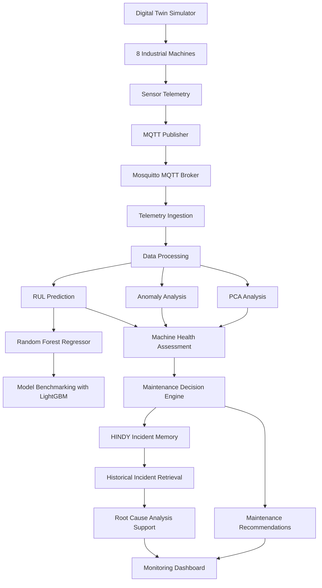
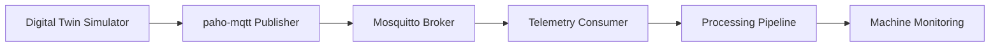
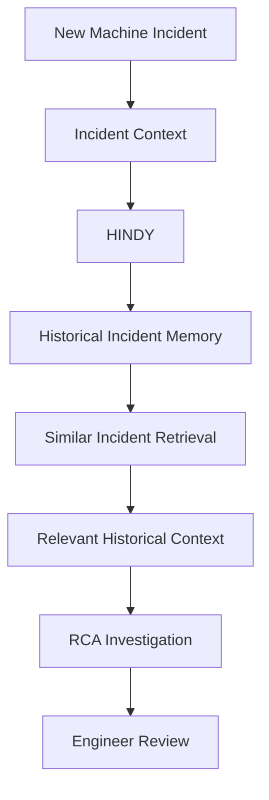

# Industrial Predictive Maintenance & Intelligent Root Cause Analysis

### An AI-powered industrial monitoring platform combining predictive maintenance, anomaly detection, Digital Twin simulation and persistent AI incident memory.

An intelligent industrial monitoring and decision-support platform designed to monitor machine health, estimate Remaining Useful Life (RUL), identify abnormal operating conditions and support Root Cause Analysis through historical incident intelligence.

The platform combines Machine Learning, sensor telemetry, Principal Component Analysis (PCA), MQTT-based communication, Digital Twin simulation and HINDY — a persistent AI incident memory agent.

---

## Overview

Unexpected industrial equipment failures can result in production downtime, maintenance costs and operational inefficiencies.

Traditional monitoring systems primarily focus on detecting current abnormalities. Predictive maintenance goes further by analysing machine behaviour and estimating potential equipment degradation.

This project extends that approach by integrating predictive analytics with Root Cause Analysis.

It brings together four major capabilities:

* **Predictive Maintenance:** Estimate machine Remaining Useful Life using machine learning.
* **Anomaly Detection:** Identify abnormal sensor behaviour and deviations from expected operating conditions.
* **Digital Twin Simulation:** Simulate multiple industrial machines and generate telemetry for monitoring.
* **Intelligent RCA:** Use HINDY's persistent incident memory to retrieve historical breakdowns and support investigations.

## Key Features

| Capability                  | Description                                                                               |
| --------------------------- | ----------------------------------------------------------------------------------------- |
| Machine Health Monitoring   | Monitor industrial machine behaviour through sensor telemetry.                            |
| RUL Estimation              | Estimate Remaining Useful Life using a Random Forest regression model.                    |
| Model Benchmarking          | Compare Random Forest and LightGBM approaches.                                            |
| PCA Analysis                | Apply Principal Component Analysis for dimensionality reduction and sensor-data analysis. |
| Anomaly Detection           | Identify unusual sensor behaviour using anomaly analysis techniques.                      |
| Digital Twin                | Simulate eight industrial machines and their telemetry.                                   |
| MQTT Communication          | Stream machine telemetry using paho-mqtt and Mosquitto compatibility.                     |
| Maintenance Decision Engine | Combine machine health, RUL and anomaly severity into maintenance recommendations.        |
| HINDY Incident Memory       | Store historical incident knowledge and retrieve similar breakdowns.                      |
| Root Cause Analysis         | Support engineers with historical incident context during investigations.                 |

---

## System Architecture

The following diagram illustrates the overall conceptual workflow of the platform.



*This diagram represents the platform's functional architecture. Refer to the implementation for the exact component connections.*

---

## 1. Industrial Machine Monitoring

The platform monitors industrial machine behaviour using sensor telemetry.

The Digital Twin Simulator represents eight machines and generates telemetry that can be ingested through the MQTT communication pipeline.

The monitoring workflow supports:

* Machine-level telemetry collection.
* Sensor behaviour analysis.
* Machine health assessment.
* Identification of abnormal operating conditions.
* Continuous monitoring through simulated telemetry.

## 2. Predictive Maintenance & RUL Estimation

Remaining Useful Life (RUL) estimation helps anticipate how much operational life a machine may have before requiring maintenance.

The project uses machine learning-based regression to estimate RUL.

### Model Development

**Random Forest Regressor**

Used as the primary RUL prediction model to estimate remaining machine life from sensor-related features.

**LightGBM**

Used as a benchmark model to compare predictive performance against Random Forest.

The model comparison provides a basis for evaluating different regression approaches for industrial predictive maintenance.

## 3. PCA-Based Sensor Analysis

Principal Component Analysis (PCA) is incorporated to analyse high-dimensional industrial sensor data.

Industrial machines generate multiple sensor measurements, which may contain correlated information.

PCA helps transform these measurements into a smaller set of principal components while retaining important patterns in the data.

Its role includes:

* Dimensionality reduction.
* Analysis of correlated sensor variables.
* Identification of dominant patterns in sensor behaviour.
* Supporting the analysis of abnormal machine operating conditions.

PCA complements the predictive maintenance and anomaly analysis pipeline.

## 4. Anomaly Detection

Anomaly analysis helps identify deviations from expected machine behaviour.

The platform considers sensor deviations and machine operating conditions to identify potentially abnormal states.

These observations contribute to the overall machine health assessment.

Anomaly severity is also considered by the maintenance decision engine when generating recommendations.

## 5. Digital Twin & MQTT Telemetry

The Digital Twin Simulator represents eight industrial machines and simulates their behaviour.

The telemetry pipeline uses MQTT for communication between the simulator and the monitoring system.

### Communication Workflow



**Technologies:**

* paho-mqtt
* MQTT
* Mosquitto

This architecture provides a communication layer for streaming simulated industrial telemetry into the monitoring platform.

## 6. Maintenance Decision Engine

Predictive outputs become more useful when translated into actionable maintenance decisions.

The decision engine combines three important inputs:

1. **Machine Health:** Overall machine operating condition.
2. **Remaining Useful Life:** Estimated remaining operational life.
3. **Anomaly Severity:** Degree of abnormal sensor behaviour.

These inputs are considered together to generate maintenance recommendations.

This connects machine monitoring and predictive analytics with practical maintenance decision support.

---

## 7. HINDY — Persistent AI Incident Memory

### From detecting failures to remembering what engineers learned.

Conventional monitoring systems help engineers understand what is happening now.

However, historical investigation knowledge can be difficult to reuse when similar failures occur again.

**HINDY** addresses this problem through persistent AI incident memory.

It is integrated into the Industrial Predictive Maintenance and RCA platform to preserve historical incident knowledge and retrieve relevant past breakdowns during new investigations.

### Core Capabilities

* **Incident Memory:** Store historical incidents and investigation knowledge.
* **Historical Retrieval:** Retrieve similar past breakdowns when a new incident occurs.
* **Contextual Investigation:** Provide relevant historical context to support Root Cause Analysis.
* **Knowledge Reuse:** Help engineers reuse previously learned troubleshooting information.

### HINDY in the RCA Workflow



HINDY complements predictive maintenance by connecting current machine behaviour with historical incident knowledge.

It acts as an investigation-support system rather than automatically declaring a confirmed root cause.

---

## End-to-End Workflow

The platform brings its components together through the following workflow:

1. **Simulation:** The Digital Twin Simulator generates telemetry for eight industrial machines.
2. **Ingestion:** MQTT transports the telemetry through a Mosquitto-compatible broker.
3. **Processing:** Sensor measurements are processed for downstream analysis.
4. **Dimensionality Reduction:** PCA supports the analysis of industrial sensor data.
5. **Prediction:** Random Forest estimates Remaining Useful Life, with LightGBM used for benchmarking.
6. **Anomaly Analysis:** Sensor deviations contribute to abnormal-condition assessment.
7. **Decision Support:** The decision engine combines machine health, RUL and anomaly severity.
8. **Incident Investigation:** HINDY retrieves similar historical incidents to support RCA.

---

## Technology Stack

| Category             | Technologies                                 |
| -------------------- | -------------------------------------------- |
| Programming Language | Python                                       |
| Backend              | FastAPI                                      |
| Frontend             | React                                        |
| Machine Learning     | Random Forest, LightGBM                      |
| Data Analysis        | PCA                                          |
| Anomaly Analysis     | Isolation Forest / sensor-deviation analysis |
| Communication        | MQTT, paho-mqtt, Mosquitto                   |
| Simulation           | Digital Twin                                 |
| AI Incident Memory   | HINDY                                        |

---

## Application Screenshots

Add actual screenshots of the application here.

Recommended screenshots:

| Screenshot             | What it should demonstrate                         |
| ---------------------- | -------------------------------------------------- |
| Monitoring Dashboard   | Overall machine health and monitoring interface    |
| Machine Details        | Individual machine sensor information              |
| Digital Twin Simulator | Eight-machine simulation                           |
| Predictive Maintenance | RUL predictions and model outputs                  |
| Anomaly Analysis       | Abnormal sensor behaviour                          |
| RCA Interface          | HINDY incident retrieval and investigation context |

Store the screenshots in a dedicated documentation or assets directory and reference their actual paths here.

---

## Getting Started

The project uses Python, FastAPI, React and MQTT-based telemetry communication.

### Prerequisites

* Python
* Node.js and npm
* MQTT broker compatible with Mosquitto
* Git

### Clone the Repository

```bash
git clone https://github.com/Siva402-ai/industrial-predictive-maintenance.git

cd industrial-predictive-maintenance
```

### Installation

Install the dependencies using the project's existing backend and frontend dependency files.

Configure the required environment variables and MQTT broker settings according to the project configuration.

Start the backend, frontend, MQTT broker and simulator using the commands defined in the repository.

*Refer to the actual project configuration for exact startup commands and ports.*

---

## Engineering Highlights

* Developed an integrated predictive maintenance workflow using machine learning.
* Applied PCA for dimensionality reduction and industrial sensor analysis.
* Compared Random Forest and LightGBM for RUL prediction.
* Developed an eight-machine Digital Twin Simulator.
* Integrated MQTT telemetry communication with Mosquitto compatibility.
* Combined machine health, RUL and anomaly severity into maintenance recommendations.
* Integrated HINDY persistent incident memory to support historical incident retrieval and Root Cause Analysis.

## Future Scope

* Improve RUL prediction through additional model experimentation.
* Extend sensor anomaly analysis and multivariate monitoring.
* Expand historical incident knowledge and retrieval capabilities.
* Improve explainability of maintenance recommendations.
* Integrate additional industrial data sources and machine configurations.

---

## Project Vision

**Predictive maintenance tells us when a machine may fail. Intelligent Root Cause Analysis helps us understand what may have happened and what was learned before.**

By combining machine learning, industrial telemetry, Digital Twin simulation and persistent AI incident memory, this project explores a more intelligent approach to industrial maintenance and operational decision support.
